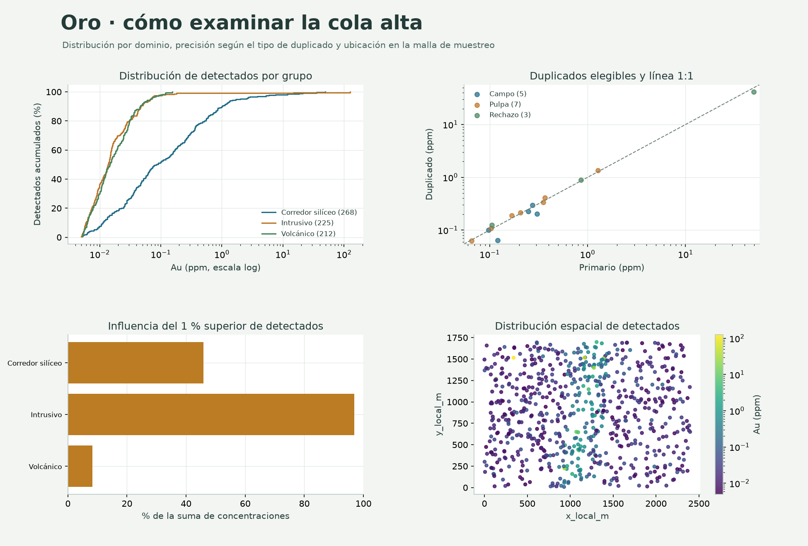

# EDA geoquímico multielemental · Proyecto Quebrada Brújula

Flujo reproducible en Python para revisar resultados de laboratorio, investigar anomalías y producir una tabla de trabajo con decisiones rastreables. El caso ficticio contiene **1.000 muestras de roca**, **12 elementos** (Au, Ag, As, Sb, Cu, Pb, Zn, Mo, Fe, Mn, Co y Ni), tres dominios geológicos y controles separados por lote.

## Empieza aquí

1. Abre la [guía geoquímica paso a paso](docs/guia_geoquimica.md). Explica cómo preparar tus archivos, adaptar las reglas, interpretar las salidas y revisar el oro.
2. Explora las [muestras sintéticas](datos/muestras_sinteticas.csv), los [controles](datos/controles_sinteticos.csv) y la [configuración editable](datos/configuracion.json).
3. Ejecuta el caso desde la raíz del proyecto con Python 3.11 o posterior.

```bash
python -m pip install -r requirements.txt
python src/ejecutar_eda.py
```

La corrida base escanea **12.000 ensayos**, distingue **520 resultados bajo el límite de reporte** y marca **10 extremos estadísticos**. Incluyendo formatos inválidos, sobrelímites y QA/QC, quedan **333 combinaciones muestra–elemento** para revisar. La corrida base conserva los valores cuantificados, incluso los que quedaron marcados. La tabla de trabajo cambia cuando se aplica una decisión documentada.

| Qué quieres revisar | Salida |
| --- | --- |
| Valores y límites originales, señales, decisiones y resultado de uso | [Analitos auditados](resultados/analitos_auditados.csv) |
| Qué casos requieren investigación | [Cola de revisión](resultados/cola_revision.csv) y [plantilla de decisiones](resultados/decisiones_plantilla.csv) |
| Concentraciones normalizadas en formato ancho | [Concentraciones de trabajo](resultados/concentraciones_uso.csv) |
| Cobertura, censura y cuantiles de cuantificados | [Resumen por elemento y grupo](resultados/resumen_elemento_grupo.csv) |
| Blancos, CRM y precisión de duplicados | [Detalle QA/QC](resultados/qaqc_detalle.csv) y [precisión por etapa](resultados/precision_duplicados.csv) |
| Distribuciones y asociaciones | [Histogramas](resultados/figuras/01_distribuciones.png), [Spearman](resultados/figuras/02_correlacion.png) y [cobertura y señales](resultados/figuras/03_calidad.png) |

## Oro y efecto pepita

El [panel de oro](resultados/figuras/04_oro.png) reúne la distribución de los valores cuantificados por dominio, los duplicados evaluables por etapa, la influencia del 1 % superior y un mapa de puntos en coordenadas ficticias. En la guía se explica cómo distinguir una anomalía geológica de una incidencia analítica y cuándo investigar la masa de muestra, la preparación y el método de reensaye.



El [ejercicio de decisiones](datos/decisiones_ejemplo.csv) corrige un error simulado en Au, conserva un alto de Au respaldado en la simulación y excluye un valor inválido de Mo. Para practicar, ejecuta las decisiones en una carpeta nueva.

```bash
python src/ejecutar_eda.py --decisiones datos/decisiones_ejemplo.csv --salida resultados/ejemplo_revisado
```

## Usa tus propios archivos

```bash
python src/ejecutar_eda.py --muestras datos/mi_campana.csv --config datos/mi_config.json --qaqc datos/mis_controles.csv --salida resultados/mi_campana
```

El QA/QC es opcional para una campaña propia. El programa informa dónde falta control. Usa la guía antes de interpretar las marcas o ajustar los umbrales. Para regenerar las entradas ficticias con la misma semilla, usa `python src/generar_sinteticos.py`.

